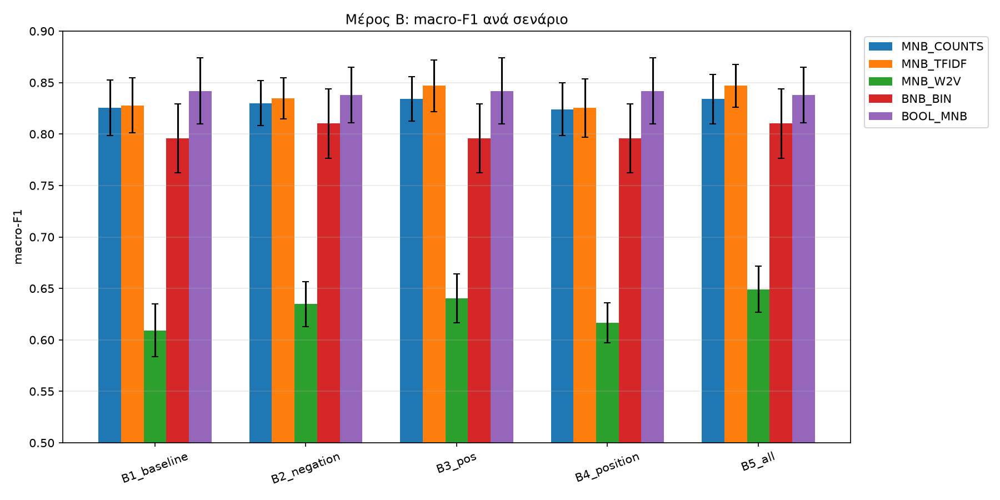

# Sentiment Analysis with Naive Bayes

Binary sentiment classification (positive / negative) of movie reviews, comparing three Naive Bayes variants, five document representations, eight preprocessing pipelines and three linguistic techniques. Every result comes from 65 experiments with 5-fold stratified cross-validation.

## Key results

| Finding | Macro-F1 |
|---|---|
| **Best overall:** Multinomial NB + TF-IDF with POS weighting | **0.847** |
| Most robust baseline: Boolean Multinomial NB (binary features) | 0.833 – 0.842 across all 8 preprocessing pipelines |
| POS weighting on TF-IDF | 0.828 → 0.847 (+1.9 points) |
| Negation handling on Boolean MNB | 0.842 → 0.838 (no gain) |
| Word2Vec (mean pooling) + Multinomial NB | 0.609 |

- **Binary features beat raw counts.** Whether a word appears matters more than how often, so Boolean MNB came out on top in every preprocessing pipeline.
- **POS weighting gave the largest single improvement.** Up-weighting adjectives and adverbs pushed TF-IDF from mid-table to the best result overall.
- **Averaged word embeddings do poorly with Naive Bayes.** Mean pooling dilutes the few strongly polarised words in each review, and Multinomial NB expects count-like features rather than dense vectors.



## Approach

**Classifier / representation combinations**

| ID | Classifier | Representation |
|----|------------|----------------|
| `MNB_COUNTS` | MultinomialNB | Term counts |
| `MNB_TFIDF` | MultinomialNB | TF-IDF |
| `MNB_W2V` | MultinomialNB | Word2Vec + mean pooling + MinMax scaling |
| `BNB_BIN` | BernoulliNB | Binary presence |
| `BOOL_MNB` | MultinomialNB | Binary presence |

**Part A: preprocessing ablation** (8 pipelines × 5 combinations = 40 experiments)
Raw text, punctuation removal, stopword removal, stopword removal that keeps negation words (*no, not, never, nor*), stemming, combinations of these, and vocabulary pruning. The best pipeline for each combination becomes its baseline for Part B.

**Part B: linguistic techniques** (5 scenarios × 5 combinations = 25 experiments)
- **Negation handling:** prefixes tokens with `NOT_` from a negation word up to the next punctuation mark
- **POS weighting:** gives more weight to sentiment-bearing parts of speech
- **Position weighting:** gives more weight to the closing sentences, where reviewers tend to state their verdict
- **All combined**

**Evaluation:** 5-fold stratified cross-validation, reporting accuracy and macro precision, recall and F1, with the standard deviation across folds. Vectorizers and Word2Vec are fitted inside each training fold, so no information leaks from the test fold.

**RapidMiner:** the `rapidminer/` folder holds equivalent processes for the binary, count and TF-IDF representations, used to cross-check the Python results.

## Running it

Requires **Python 3.12 or 3.13**. gensim has no wheels for 3.14 yet.

```bash
python3.12 -m venv .venv
source .venv/bin/activate
pip install -r requirements.txt
python -c "import nltk; nltk.download('stopwords'); nltk.download('averaged_perceptron_tagger_eng')"
```

Download the [polarity dataset v2.0](https://www.cs.cornell.edu/people/pabo/movie-review-data/) and place it as:

```
data/txt_sentoken/pos/   1000 .txt files
data/txt_sentoken/neg/   1000 .txt files
```

Then run:

```bash
python main.py          # all experiments, ~15-20 min, runs sequentially
```

To redraw the figures from the saved CSVs without rerunning the experiments:

```bash
python -c "import main; main.make_plots()"
```

## Project structure

```
main.py              runs Part A and Part B, draws the figures
src/preprocess.py    loading, cleaning, negation, POS and position weighting
src/models.py        the 5 classifier / representation combinations
src/experiments.py   cross-validation loop and metrics
results/             per-fold metrics (CSV), baseline choices, figures
rapidminer/          RapidMiner processes
```

## Data

Pang, B. & Lee, L. (2004). *A Sentimental Education: Sentiment Analysis Using Subjectivity Summarization Based on Minimum Cuts.* ACL 2004.

---

Course project for *Search Engines*, Department of Applied Informatics, University of Macedonia.
